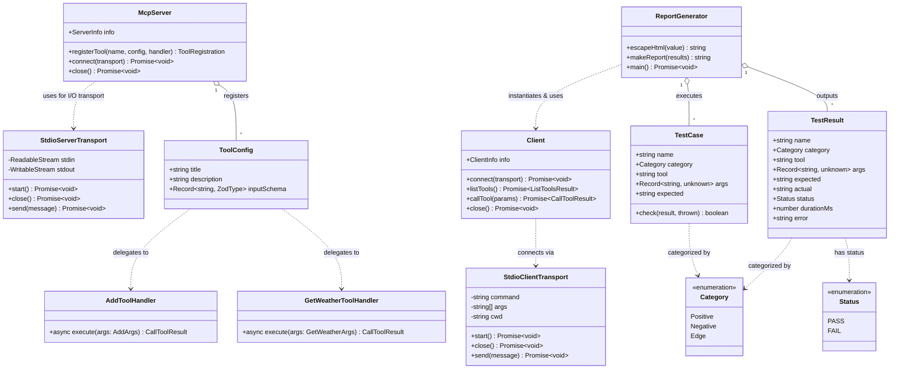

# Class Architecture Documentation

This document describes the primary classes, interfaces, and component structures in the **MCP Inspector Demo** application, including the Model Context Protocol (MCP) server lifecycle, transport layers, test client harness, and data structures.

## UML Class Diagram



---

## Detailed Class & Interface Reference

### 1. `McpServer`
* **Source:** `@modelcontextprotocol/sdk/server/mcp.js`
* **Role:** High-level MCP server instance responsible for registering tools, resources, and prompts, and binding them to protocol transports.
* **Key Properties & Methods:**
  - `constructor({ name: string, version: string })`: Initializes the MCP server instance.
  - `registerTool(name: string, config: ToolConfig, handler: ToolHandler)`: Registers a tool name, input schema (Zod), title, description, and execution handler function.
  - `connect(transport: Transport)`: Connects the server to a transport instance (e.g., `StdioServerTransport`).

### 2. `StdioServerTransport`
* **Source:** `@modelcontextprotocol/sdk/server/stdio.js`
* **Role:** Implements MCP JSON-RPC protocol transport using standard input (`process.stdin`) and standard output (`process.stdout`).
* **Key Behavior:**
  - Protocol JSON-RPC messages are read from stdin and written to stdout.
  - Diagnostic and application logs are directed to `process.stderr` to prevent JSON-RPC stream corruption.

### 3. `Client`
* **Source:** `@modelcontextprotocol/sdk/client/index.js`
* **Role:** MCP Client interface used in test suites and tools like MCP Inspector to query server capabilities and execute tool calls.
* **Key Properties & Methods:**
  - `constructor({ name: string, version: string })`: Initializes client metadata.
  - `connect(transport: Transport)`: Connects client to server via chosen transport.
  - `listTools()`: Issues `tools/list` protocol request to retrieve registered tools and their schemas.
  - `callTool({ name, arguments })`: Issues `tools/call` protocol request to invoke a specific tool.
  - `close()`: Closes connection and cleans up transport child processes.

### 4. `StdioClientTransport`
* **Source:** `@modelcontextprotocol/sdk/client/stdio.js`
* **Role:** Client-side transport that spawns the MCP server child process and manages stdin/stdout JSON-RPC communication.
* **Configuration:**
  - `command`: `npx` / `npx.cmd`
  - `args`: `["tsx", "src/index.ts"]`
  - `cwd`: Project root directory path.

### 5. Custom Domain Tools & Handlers
Defined in `mcp-inspector-demo/src/index.ts`:

#### Tool: `add`
* **Title:** Add Numbers
* **Description:** Add two numbers and return their sum.
* **Input Schema:**
  - `a`: `z.number().describe("First number")`
  - `b`: `z.number().describe("Second number")`
* **Output Format:** Text block `Result: <sum>`

#### Tool: `get_weather`
* **Title:** Get Weather
* **Description:** Get demo weather data for a city (mock data).
* **Input Schema:**
  - `city`: `z.string().min(1).describe("City name")`
* **Output Format:** JSON text string containing `city`, `temperatureC`, `condition`, `humidity`, and `source`.

---

## Test & Reporting Interfaces

Defined in `mcp-inspector-demo/src/test-report.ts`:

### 1. `TestCase` Interface
Defines the structure of automated test definitions used by the test runner.

```typescript
interface TestCase {
  name: string;
  category: Category; // 'Positive' | 'Negative' | 'Edge'
  tool: string;
  args: Record<string, unknown>;
  expected: string;
  check: (result: any, thrown?: string) => boolean;
}
```

### 2. `TestResult` Interface
Represents the result of executing a single test case.

```typescript
interface TestResult {
  name: string;
  category: Category;
  tool: string;
  args: Record<string, unknown>;
  expected: string;
  actual: string;
  status: "PASS" | "FAIL";
  durationMs: number;
  error?: string;
}
```

### 3. `ReportGenerator` Functions
- `escapeHtml(value: unknown): string`: Sanitizes values for safe embedding in HTML output.
- `makeReport(results: TestResult[]): string`: Renders an interactive HTML QA report containing summary statistics, cards, filter controls, and test result tables.
- `main(): Promise<void>`: Test suite executor that boots server via `StdioClientTransport`, runs all `TestCase` items, records performance metrics, and writes `reports/mcp-test-report.html`.
