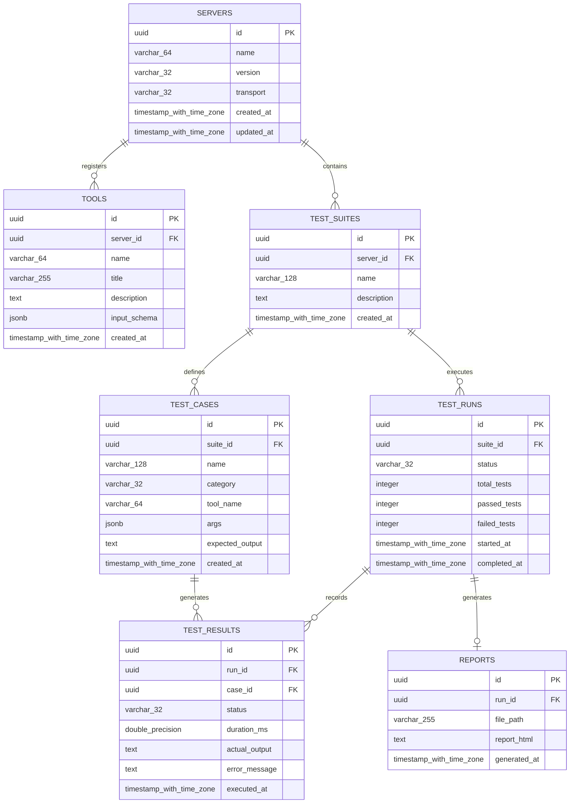

# Database Documentation

This document describes the PostgreSQL database schema used by the **MCP Inspector Demo** platform for persisting MCP server metadata, registered tools, test suites, test run execution logs, and generated report records.

## Entity-Relationship Diagram (ERD)



---

## Schema & Tables

### 1. `servers`

Stores details of registered MCP servers.

| Field | Type | Constraints | Description |
|---|---|---|---|
| `id` | `UUID` | `PRIMARY KEY`, Default `gen_random_uuid()` | Unique identifier for the server record |
| `name` | `VARCHAR(64)` | `NOT NULL` | Unique name of the MCP server (e.g. `mcp-inspector-demo`) |
| `version` | `VARCHAR(32)` | `NOT NULL` | Version string of the MCP server |
| `transport` | `VARCHAR(32)` | `NOT NULL`, Default `'stdio'` | Transport protocol used (`stdio`, `sse`, `http`) |
| `created_at` | `TIMESTAMPTZ` | `NOT NULL`, Default `NOW()` | Timestamp when the server entry was created |
| `updated_at` | `TIMESTAMPTZ` | `NOT NULL`, Default `NOW()` | Timestamp when the server entry was last updated |

**Indexes:**
- `idx_servers_name` (`name` UNIQUE)

---

### 2. `tools`

Stores registered tools exposed by MCP servers.

| Field | Type | Constraints | Description |
|---|---|---|---|
| `id` | `UUID` | `PRIMARY KEY`, Default `gen_random_uuid()` | Unique identifier for the tool |
| `server_id` | `UUID` | `NOT NULL`, `REFERENCES servers(id) ON DELETE CASCADE` | Reference to the owning server |
| `name` | `VARCHAR(64)` | `NOT NULL` | Name of the tool (e.g., `add`, `get_weather`) |
| `title` | `VARCHAR(255)` | `NULL` | Human-readable title for UI representation |
| `description` | `TEXT` | `NULL` | Detailed explanation of what the tool does |
| `input_schema` | `JSONB` | `NOT NULL` | JSON schema representation of tool input arguments |
| `created_at` | `TIMESTAMPTZ` | `NOT NULL`, Default `NOW()` | Registration timestamp |

**Indexes:**
- `idx_tools_server_id` (`server_id`)
- `idx_tools_server_name` (`server_id`, `name` UNIQUE)

---

### 3. `test_suites`

Groups test cases for evaluating MCP server implementations.

| Field | Type | Constraints | Description |
|---|---|---|---|
| `id` | `UUID` | `PRIMARY KEY`, Default `gen_random_uuid()` | Unique identifier for the test suite |
| `server_id` | `UUID` | `NOT NULL`, `REFERENCES servers(id) ON DELETE CASCADE` | Server target for this test suite |
| `name` | `VARCHAR(128)` | `NOT NULL` | Test suite name |
| `description` | `TEXT` | `NULL` | Description of suite scope and objectives |
| `created_at` | `TIMESTAMPTZ` | `NOT NULL`, Default `NOW()` | Creation timestamp |

**Indexes:**
- `idx_test_suites_server_id` (`server_id`)

---

### 4. `test_cases`

Individual test definitions within a test suite.

| Field | Type | Constraints | Description |
|---|---|---|---|
| `id` | `UUID` | `PRIMARY KEY`, Default `gen_random_uuid()` | Unique test case ID |
| `suite_id` | `UUID` | `NOT NULL`, `REFERENCES test_suites(id) ON DELETE CASCADE` | Parent test suite reference |
| `name` | `VARCHAR(128)` | `NOT NULL` | Descriptive title of the test case |
| `category` | `VARCHAR(32)` | `NOT NULL` | Category classification (`Positive`, `Negative`, `Edge`) |
| `tool_name` | `VARCHAR(64)` | `NOT NULL` | Target tool to execute |
| `args` | `JSONB` | `NOT NULL`, Default `'{}'::jsonb` | Arguments passed to tool invocation |
| `expected_output` | `TEXT` | `NOT NULL` | Description or value of expected result |
| `created_at` | `TIMESTAMPTZ` | `NOT NULL`, Default `NOW()` | Creation timestamp |

**Indexes:**
- `idx_test_cases_suite_id` (`suite_id`)
- `idx_test_cases_category` (`category`)

---

### 5. `test_runs`

Records executions of a test suite.

| Field | Type | Constraints | Description |
|---|---|---|---|
| `id` | `UUID` | `PRIMARY KEY`, Default `gen_random_uuid()` | Unique execution run ID |
| `suite_id` | `UUID` | `NOT NULL`, `REFERENCES test_suites(id) ON DELETE CASCADE` | Reference to executed test suite |
| `status` | `VARCHAR(32)` | `NOT NULL`, Default `'RUNNING'` | Status (`RUNNING`, `PASSED`, `FAILED`, `CANCELLED`) |
| `total_tests` | `INTEGER` | `NOT NULL`, Default `0` | Total number of executed test cases |
| `passed_tests` | `INTEGER` | `NOT NULL`, Default `0` | Number of passing test cases |
| `failed_tests` | `INTEGER` | `NOT NULL`, Default `0` | Number of failing test cases |
| `started_at` | `TIMESTAMPTZ` | `NOT NULL`, Default `NOW()` | Execution start time |
| `completed_at` | `TIMESTAMPTZ` | `NULL` | Execution completion time |

**Indexes:**
- `idx_test_runs_suite_id` (`suite_id`)
- `idx_test_runs_status` (`status`)

---

### 6. `test_results`

Stores individual test case results for a test run.

| Field | Type | Constraints | Description |
|---|---|---|---|
| `id` | `UUID` | `PRIMARY KEY`, Default `gen_random_uuid()` | Result record identifier |
| `run_id` | `UUID` | `NOT NULL`, `REFERENCES test_runs(id) ON DELETE CASCADE` | Parent test run |
| `case_id` | `UUID` | `NULL`, `REFERENCES test_cases(id) ON DELETE SET NULL` | Corresponding test case definition |
| `status` | `VARCHAR(32)` | `NOT NULL` | Evaluation outcome (`PASS`, `FAIL`) |
| `duration_ms` | `DOUBLE PRECISION` | `NOT NULL` | Test execution duration in milliseconds |
| `actual_output` | `TEXT` | `NULL` | Formatted output or payload returned by tool |
| `error_message` | `TEXT` | `NULL` | Error details or exception message if test failed |
| `executed_at` | `TIMESTAMPTZ` | `NOT NULL`, Default `NOW()` | Timestamp when test case was evaluated |

**Indexes:**
- `idx_test_results_run_id` (`run_id`)
- `idx_test_results_status` (`status`)

---

### 7. `reports`

Stores generated HTML QA reports corresponding to test runs.

| Field | Type | Constraints | Description |
|---|---|---|---|
| `id` | `UUID` | `PRIMARY KEY`, Default `gen_random_uuid()` | Report identifier |
| `run_id` | `UUID` | `NOT NULL`, `UNIQUE`, `REFERENCES test_runs(id) ON DELETE CASCADE` | Test run linked to this report |
| `file_path` | `VARCHAR(255)` | `NOT NULL` | Disk location relative path (e.g. `reports/mcp-test-report.html`) |
| `report_html` | `TEXT` | `NOT NULL` | Complete rendered HTML contents of the QA report |
| `generated_at` | `TIMESTAMPTZ` | `NOT NULL`, Default `NOW()` | Report generation timestamp |

**Indexes:**
- `idx_reports_run_id` (`run_id` UNIQUE)

---

## SQL DDL Script

```sql
CREATE EXTENSION IF NOT EXISTS "pgcrypto";

CREATE TABLE servers (
    id UUID PRIMARY KEY DEFAULT gen_random_uuid(),
    name VARCHAR(64) NOT NULL UNIQUE,
    version VARCHAR(32) NOT NULL,
    transport VARCHAR(32) NOT NULL DEFAULT 'stdio',
    created_at TIMESTAMPTZ NOT NULL DEFAULT NOW(),
    updated_at TIMESTAMPTZ NOT NULL DEFAULT NOW()
);

CREATE TABLE tools (
    id UUID PRIMARY KEY DEFAULT gen_random_uuid(),
    server_id UUID NOT NULL REFERENCES servers(id) ON DELETE CASCADE,
    name VARCHAR(64) NOT NULL,
    title VARCHAR(255),
    description TEXT,
    input_schema JSONB NOT NULL,
    created_at TIMESTAMPTZ NOT NULL DEFAULT NOW(),
    CONSTRAINT uq_tools_server_name UNIQUE (server_id, name)
);

CREATE TABLE test_suites (
    id UUID PRIMARY KEY DEFAULT gen_random_uuid(),
    server_id UUID NOT NULL REFERENCES servers(id) ON DELETE CASCADE,
    name VARCHAR(128) NOT NULL,
    description TEXT,
    created_at TIMESTAMPTZ NOT NULL DEFAULT NOW()
);

CREATE TABLE test_cases (
    id UUID PRIMARY KEY DEFAULT gen_random_uuid(),
    suite_id UUID NOT NULL REFERENCES test_suites(id) ON DELETE CASCADE,
    name VARCHAR(128) NOT NULL,
    category VARCHAR(32) NOT NULL,
    tool_name VARCHAR(64) NOT NULL,
    args JSONB NOT NULL DEFAULT '{}'::jsonb,
    expected_output TEXT NOT NULL,
    created_at TIMESTAMPTZ NOT NULL DEFAULT NOW()
);

CREATE TABLE test_runs (
    id UUID PRIMARY KEY DEFAULT gen_random_uuid(),
    suite_id UUID NOT NULL REFERENCES test_suites(id) ON DELETE CASCADE,
    status VARCHAR(32) NOT NULL DEFAULT 'RUNNING',
    total_tests INTEGER NOT NULL DEFAULT 0,
    passed_tests INTEGER NOT NULL DEFAULT 0,
    failed_tests INTEGER NOT NULL DEFAULT 0,
    started_at TIMESTAMPTZ NOT NULL DEFAULT NOW(),
    completed_at TIMESTAMPTZ
);

CREATE TABLE test_results (
    id UUID PRIMARY KEY DEFAULT gen_random_uuid(),
    run_id UUID NOT NULL REFERENCES test_runs(id) ON DELETE CASCADE,
    case_id UUID REFERENCES test_cases(id) ON DELETE SET NULL,
    status VARCHAR(32) NOT NULL,
    duration_ms DOUBLE PRECISION NOT NULL,
    actual_output TEXT,
    error_message TEXT,
    executed_at TIMESTAMPTZ NOT NULL DEFAULT NOW()
);

CREATE TABLE reports (
    id UUID PRIMARY KEY DEFAULT gen_random_uuid(),
    run_id UUID NOT NULL UNIQUE REFERENCES test_runs(id) ON DELETE CASCADE,
    file_path VARCHAR(255) NOT NULL,
    report_html TEXT NOT NULL,
    generated_at TIMESTAMPTZ NOT NULL DEFAULT NOW()
);

CREATE INDEX idx_tools_server_id ON tools(server_id);
CREATE INDEX idx_test_suites_server_id ON test_suites(server_id);
CREATE INDEX idx_test_cases_suite_id ON test_cases(suite_id);
CREATE INDEX idx_test_cases_category ON test_cases(category);
CREATE INDEX idx_test_runs_suite_id ON test_runs(suite_id);
CREATE INDEX idx_test_runs_status ON test_runs(status);
CREATE INDEX idx_test_results_run_id ON test_results(run_id);
CREATE INDEX idx_test_results_status ON test_results(status);
```